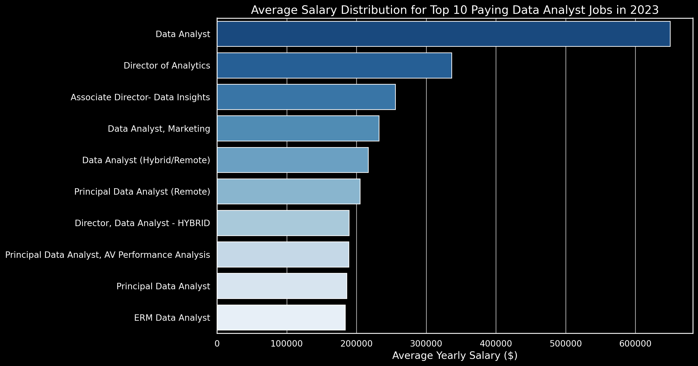
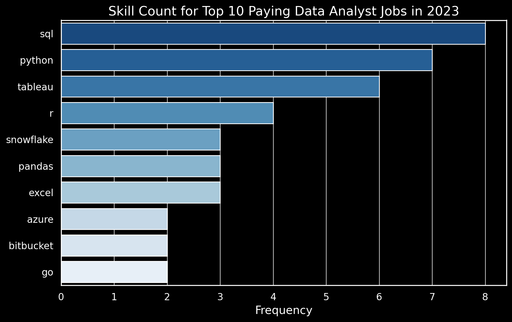

# SQL Data Job Market Analysis

## Introduction

This is my SQL project, where I wanted to move beyond learning SQL syntax and use it to answer real questions with a real dataset. Exploring the Data Analyst job market felt like a natural place to start: I could practice writing queries while discovering which jobs pay the most, which skills employers look for, and which skills might be worth learning next.

The project examines **2023 Data Analyst job postings**, focusing on remote opportunities, in-demand skills, and the relationship between skills and salaries.

🔍 **My SQL queries:** [Explore the `project_sql` folder](./project_sql/)

## Background

I completed this project while learning SQL through [Luke Barousse's SQL for Data Analytics course](https://www.lukebarousse.com/sql), using the course dataset and project questions. I wrote my own versions of the SQL queries and obtained the same results as the reference analysis.

The dataset contains job postings, company details, salaries, and skills. I set out to answer five questions:

1. What are the highest-paying remote Data Analyst jobs?
2. Which skills are required for those top-paying jobs?
3. Which skills are most in demand for remote Data Analysts?
4. Which skills are associated with the highest average salaries for remote Data Analysts?
5. Which skills offer a strong combination of demand and salary?

**Analysis scope:** Queries 1 and 2 identify remote opportunities with `job_location = 'Anywhere'`; queries 3–5 use `job_work_from_home = TRUE`. Salary-based analyses exclude postings without an average yearly salary.

## Tools I Used

- **SQL:** Filtering, joining datasets, grouping records, calculating aggregates, and ranking results.
- **PostgreSQL:** Querying the jobs-and-skills database.
- **Visual Studio Code:** Writing and organizing my SQL scripts.
- **Git & GitHub:** Managing project files and sharing the analysis.

## The Analysis

Below are my SQL queries, the results I obtained, and my interpretation of those results.

### 1. Top-Paying Remote Data Analyst Jobs

To find the highest-paying remote positions, I joined the jobs table with company data, filtered for Data Analyst roles located `Anywhere`, and sorted by yearly salary in descending order.

**SQL:** [`1_top_paying_jobs.sql`](./project_sql/1_top_paying_jobs.sql)

```sql
SELECT
    company_dim.name AS company_name,
    job_title,
    job_location,
    job_schedule_type,
    salary_year_avg,
    job_posted_date
FROM
    job_postings_fact
INNER JOIN company_dim ON job_postings_fact.company_id = company_dim.company_id
WHERE
    salary_year_avg IS NOT NULL AND
    job_title_short = 'Data Analyst' AND
    job_location = 'Anywhere'
ORDER BY
    salary_year_avg DESC
LIMIT 10;
```

#### Results

The ten highest-paying remote Data Analyst postings in the 2023 dataset range from **$184,000 to $650,000 per year**. The employers include companies such as SmartAsset, Meta, and AT&T, and the titles cover both analyst and senior analytics leadership positions.



*Figure 1. Average yearly salaries for the ten highest-paying remote Data Analyst postings in 2023.*

**My takeaway:** Remote Data Analyst roles can have a wide salary range. Job title and level matter, so the highest listed salaries should not be treated as typical salaries for every Data Analyst.

### 2. Skills Required for Top-Paying Jobs

I used a **Common Table Expression (CTE)** to select the ten highest-paying remote jobs, then joined those jobs to their listed skills. This shows which technologies appear most often among the top-paying opportunities.

**SQL:** [`2_top_paying_skills.sql`](./project_sql/2_top_paying_skills.sql)

```sql
WITH top_10_jobs AS (
    SELECT
        company_dim.name AS company_name,
        job_id,
        job_title,
        salary_year_avg
    FROM
        job_postings_fact
    INNER JOIN company_dim ON job_postings_fact.company_id = company_dim.company_id
    WHERE
        salary_year_avg IS NOT NULL AND
        job_title_short = 'Data Analyst' AND
        job_location = 'Anywhere'
    ORDER BY
        salary_year_avg DESC
    LIMIT 10
)
SELECT
    top_10_jobs.*,
    skills
FROM top_10_jobs
INNER JOIN skills_job_dim ON skills_job_dim.job_id = top_10_jobs.job_id
INNER JOIN skills_dim ON skills_dim.skill_id = skills_job_dim.skill_id
ORDER BY salary_year_avg DESC
```

#### Results

Across these ten postings, **SQL appears in 8**, **Python in 7**, and **Tableau in 6**. This gives a clear indication of the importance of database querying, programming, and data visualization in higher-paying analytical roles.



*Figure 2. Counts of skills listed in the ten highest-paying postings*

| Skill | Number of top-10 postings |
|:---|---:|
| SQL | 8 |
| Python | 7 |
| Tableau | 6 |
| R | 4 |
| Snowflake | 3 |
| Pandas | 3 |
| Excel | 3 |
| Azure | 2 |
| Bitbucket | 2 |
| Go | 2 |

**My takeaway:** SQL and Python are particularly valuable foundational skills, while Tableau and other tools add important analytical and visualization capabilities.

### 3. Most In-Demand Skills for Remote Data Analysts

For this question, I counted how frequently each skill appeared in remote Data Analyst job postings and returned the five skills with the highest counts.

**SQL:** [`3_top_demanded_skills.sql`](./project_sql/3_top_demanded_skills.sql)

```sql
SELECT
    skills,
    COUNT(*) AS times_skill_mentioned
FROM
    skills_job_dim
INNER JOIN skills_dim ON skills_dim.skill_id = skills_job_dim.skill_id
INNER JOIN job_postings_fact ON job_postings_fact.job_id = skills_job_dim.job_id
WHERE
    job_title_short = 'Data Analyst' AND
    job_work_from_home = TRUE
GROUP BY
    skills
ORDER BY
    times_skill_mentioned DESC
LIMIT 5;
```

#### Results

| Skill | Demand count |
|:---|---:|
| SQL | 7,291 |
| Excel | 4,611 |
| Python | 4,330 |
| Tableau | 3,745 |
| Power BI | 2,609 |

*Table 1. Five most requested skills among remote Data Analyst postings in the 2023 dataset.*

**My takeaway:** SQL has the highest demand count, followed by Excel and Python. Tableau and Power BI show that dashboarding and presenting data are also central to analyst roles.

### 4. Highest-Paying Skills for Remote Data Analysts

Next, I grouped remote Data Analyst postings by skill, calculated the **average annual salary** associated with each one, and ranked the skills from highest to lowest. This helps identify specialized technologies that appear in higher-paying roles.

**SQL:** [`4_top_paying_skills.sql`](./project_sql/4_top_paying_skills.sql)

```sql
SELECT
    skills,
    ROUND(AVG(job_postings_fact.salary_year_avg),0) AS salary_avg
FROM
    skills_job_dim
INNER JOIN skills_dim ON skills_dim.skill_id = skills_job_dim.skill_id
INNER JOIN job_postings_fact ON job_postings_fact.job_id = skills_job_dim.job_id
WHERE
    job_title_short = 'Data Analyst'
    AND salary_year_avg IS NOT NULL
    AND job_work_from_home = TRUE
GROUP BY
    skills
ORDER BY
    salary_avg DESC
LIMIT 25;
```

#### Results

The SQL query returns the **top 25 skills** by average salary. Here are the top ten, matching the reference results:

| Skill | Average yearly salary (USD) |
|:---|---:|
| PySpark | $208,172 |
| Bitbucket | $189,155 |
| Couchbase | $160,515 |
| Watson | $160,515 |
| DataRobot | $155,486 |
| GitLab | $154,500 |
| Swift | $153,750 |
| Jupyter | $152,777 |
| Pandas | $151,821 |
| Elasticsearch | $145,000 |

*Table 2. Top ten skills by average listed salary among remote Data Analyst jobs with salary data*

**My takeaway:** Specialized big-data, cloud, programming, and machine-learning tools are associated with some of the largest average salaries. However, average pay is not the same as a guaranteed salary premium: uncommon skills may have fewer postings behind their averages.

### 5. Optimal Skills: Balancing Salary and Demand

Finally, I combined **average salary** and **number of skill mentions** to see which skills offer an appealing balance of pay and market demand. I kept only skills mentioned more than ten times in the relevant remote postings.

My SQL file includes two ways to reach the same result: a compact query using aggregation, and a second version that separates the salary and demand calculations into **two CTEs**.

**SQL:** [`5_optimal_skills.sql`](./project_sql/5_optimal_skills.sql)

**Approach 1: One query**

```sql
SELECT
    skills_job_dim.skill_id,
    skills_dim.skills,
    ROUND(AVG(job_postings_fact.salary_year_avg),0) AS salary_avg,
    COUNT(skills_job_dim.*) AS times_skill_mentioned
    FROM
        skills_job_dim
    INNER JOIN skills_dim ON skills_dim.skill_id = skills_job_dim.skill_id
    INNER JOIN job_postings_fact ON job_postings_fact.job_id = skills_job_dim.job_id
WHERE
    job_title_short = 'Data Analyst'
    AND salary_year_avg IS NOT NULL
    AND job_work_from_home = TRUE
GROUP BY
    skills_job_dim.skill_id,
    skills
HAVING
    COUNT(skills_job_dim.*) > 10
ORDER BY
    salary_avg DESC,
    times_skill_mentioned DESC
LIMIT 25;
```

#### Results

This approach identifies the following leading skills when sorted by average salary, subject to the minimum-demand threshold:

| Skill ID | Skill | Demand count | Average yearly salary (USD) |
|---:|:---|---:|---:|
| 8 | Go | 27 | $115,320 |
| 234 | Confluence | 11 | $114,210 |
| 97 | Hadoop | 22 | $113,193 |
| 80 | Snowflake | 37 | $112,948 |
| 74 | Azure | 34 | $111,225 |
| 77 | BigQuery | 13 | $109,654 |
| 76 | AWS | 32 | $108,317 |
| 4 | Java | 17 | $106,906 |
| 194 | SSIS | 12 | $106,683 |
| 233 | Jira | 20 | $104,918 |

*Table 3. Top ten entries of the 25-skill ranking for remote Data Analyst jobs, filtered to skills with more than ten salary-observed mentions.*

The wider results also show that **Python (236 mentions; $101,397 average salary)** and **R (148 mentions; $100,499)** combine substantial demand with competitive salaries. Business-intelligence tools such as **Tableau (230; $99,288)** and **Looker (49; $103,795)** also stand out.

**My takeaway:** The best skill to learn is not necessarily the one with the highest observed salary. SQL, Python, cloud data tools, and visualization technologies serve different needs; comparing demand with compensation is a more useful starting point for deciding where to invest learning time.

## What I Learned

Since this was my first SQL project, the biggest benefit was getting comfortable using SQL to investigate questions rather than simply complete isolated exercises. In particular, I practiced:

- **Joining tables:** Using `INNER JOIN` to connect job postings, companies, and skills.
- **Writing CTEs:** Breaking larger problems into understandable steps with `WITH`.
- **Aggregating data:** Applying `COUNT()`, `AVG()`, and `ROUND()` to summarize job market trends.
- **Filtering grouped results:** Using `WHERE`, `GROUP BY`, and `HAVING` appropriately.
- **Ranking results:** Combining `ORDER BY` and `LIMIT` to focus on the most relevant information.
- **Interpreting results:** Thinking about sample size, missing salaries, and why high-paying skills are not automatically the most in demand.

## Conclusions

Working with the 2023 Data Analyst postings helped me turn SQL queries into insights about the job market:

1. **Top-paying remote jobs:** The ten highest-paying postings range from **$184,000 to $650,000 annually**, showing how much seniority and specialization can affect compensation.
2. **Skills in top-paying jobs:** **SQL, Python, and Tableau** lead among the ten highest-paying listings.
3. **Most demanded skills:** **SQL (7,291 mentions)** ranks first for remote Data Analyst jobs, ahead of Excel, Python, Tableau, and Power BI.
4. **Skills with higher average pay:** Specialized tools like **PySpark** and **Bitbucket** have high observed average salaries, although sample sizes matter.
5. **Balancing salary and demand:** Cloud and data-platform skills such as **Snowflake, Azure, AWS, and BigQuery** appear among the attractive options once a minimum-demand threshold is applied.

### Final Thoughts

This project was my starting point in SQL-based data analysis. It helped me understand how to transform raw job posting data into meaningful answers, strengthened my confidence with SQL, and gave me a foundation for more independent data projects in the future.

## Project Structure

```text
Data_Analysis_SQL_Course/
├── project_sql/
│   ├── 1_top_paying_jobs.sql
│   ├── 2_top_paying_skills.sql
│   ├── 3_top_demanded_skills.sql
│   ├── 4_top_paying_skills.sql
│   └── 5_optimal_skills.sql
├── sql_load/
├── .gitignore
└── README.md
```

## Acknowledgments

This project was completed using the dataset and learning materials from **[Luke Barousse's SQL for Data Analytics course](https://www.lukebarousse.com/sql)**. Thanks to Luke for the project framework, example analysis, and charts linked above. The SQL queries shown here are **my own versions** of the exercises.
